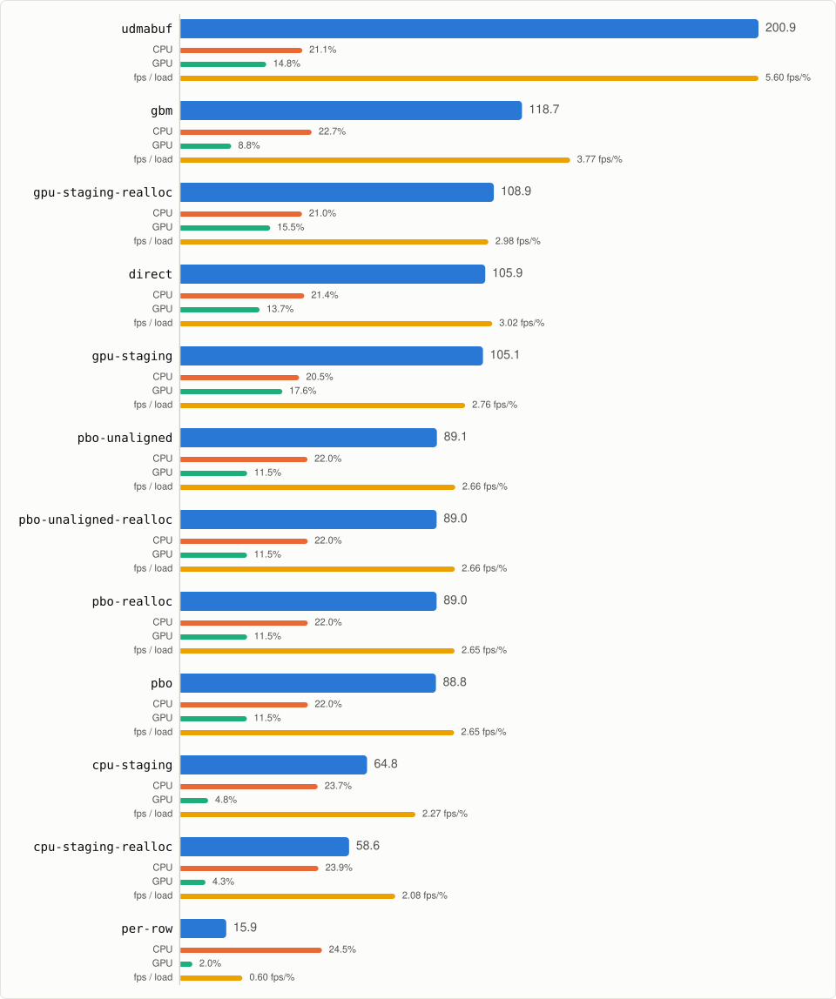
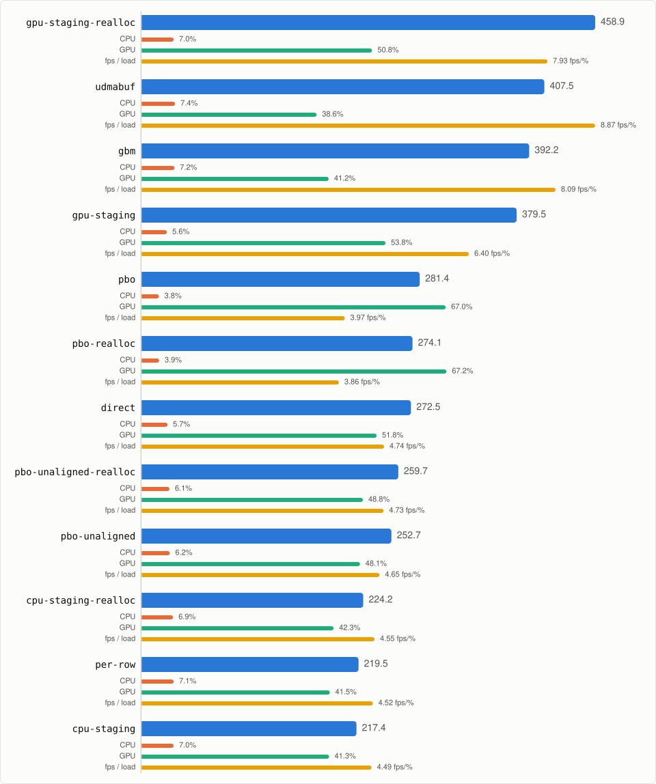

# glReadPixels benchmark

## galago

- **crop**: 1280x720+320+180
- **frame**: 1920x1080
- **duration**: 1 s
- **warmup**: 10 frames
- **format**: RGBA8888
- **renderer**: Mesa Intel(R) UHD Graphics (CML GT2)
- **version**: OpenGL ES 3.2 Mesa 26.2.5-arch1.1

<picture>
  <source media="(prefers-color-scheme: dark)" srcset="assets/815b557a8a5ca7c424259cc58d360ae3cf80baf4-dark.svg">
  
</picture>

## rpi5

- **crop**: 1280x720+320+180
- **frame**: 1920x1080
- **duration**: 1 s
- **warmup**: 10 frames
- **format**: RGBA8888
- **renderer**: V3D 7.1.7.0
- **version**: OpenGL ES 3.1 Mesa 26.2.2-1~bpo13+0~rpt1

<picture>
  <source media="(prefers-color-scheme: dark)" srcset="assets/7d52d3377ead426622bb49fdb6485c5a84be48fb-dark.svg">
  
</picture>

## tp-a485

- **crop**: 1280x720+320+180
- **frame**: 1920x1080
- **duration**: 1 s
- **warmup**: 10 frames
- **format**: RGBA8888
- **renderer**: AMD Radeon Vega 8 Graphics (radeonsi, raven, ACO, DRM 3.64, 7.2.9-arch1-1)
- **version**: OpenGL ES 3.2 Mesa 26.2.4-arch1.1

<picture>
  <source media="(prefers-color-scheme: dark)" srcset="assets/079f036a7ca2c14678df419481d3f6c6a1b76ff0-dark.svg">
  
</picture>

# Capture snippets

## gpu-staging

```c
unsigned char *dst;
GLuint tex, fbo;

dst = malloc(w * h * 4);

glGenTextures(1, &tex);
glBindTexture(GL_TEXTURE_2D, tex);
glTexImage2D(GL_TEXTURE_2D, 0, GL_RGBA, w, h, 0, GL_RGBA,
	     GL_UNSIGNED_BYTE, NULL);
glGenFramebuffers(1, &fbo);
glBindFramebuffer(GL_FRAMEBUFFER, fbo);
glFramebufferTexture2D(GL_FRAMEBUFFER, GL_COLOR_ATTACHMENT0,
		       GL_TEXTURE_2D, tex, 0);

while (elapsed() < duration) {
	draw_triangle(render_fbo);

	glBindFramebuffer(GL_FRAMEBUFFER, render_fbo);
	glBindTexture(GL_TEXTURE_2D, tex);
	glCopyTexSubImage2D(GL_TEXTURE_2D, 0, 0, 0, x, y, w, h);
	glBindFramebuffer(GL_FRAMEBUFFER, fbo);
	glReadPixels(0, 0, w, h, GL_RGBA, GL_UNSIGNED_BYTE, dst);

	frames++;
}

glDeleteFramebuffers(1, &fbo);
glDeleteTextures(1, &tex);

free(dst);
```

## gpu-staging-realloc

```c
unsigned char *dst;
GLuint tex, fbo;

dst = malloc(w * h * 4);

while (elapsed() < duration) {
	draw_triangle(render_fbo);

	glGenTextures(1, &tex);
	glBindTexture(GL_TEXTURE_2D, tex);
	glTexImage2D(GL_TEXTURE_2D, 0, GL_RGBA, w, h, 0, GL_RGBA,
		     GL_UNSIGNED_BYTE, NULL);
	glGenFramebuffers(1, &fbo);
	glBindFramebuffer(GL_FRAMEBUFFER, fbo);
	glFramebufferTexture2D(GL_FRAMEBUFFER, GL_COLOR_ATTACHMENT0,
			       GL_TEXTURE_2D, tex, 0);

	glBindFramebuffer(GL_FRAMEBUFFER, render_fbo);
	glBindTexture(GL_TEXTURE_2D, tex);
	glCopyTexSubImage2D(GL_TEXTURE_2D, 0, 0, 0, x, y, w, h);
	glBindFramebuffer(GL_FRAMEBUFFER, fbo);
	glReadPixels(0, 0, w, h, GL_RGBA, GL_UNSIGNED_BYTE, dst);

	glDeleteFramebuffers(1, &fbo);
	glDeleteTextures(1, &tex);

	frames++;
}

free(dst);
```

## cpu-staging

```c
unsigned char *dst;
unsigned char *staging;
int row;

dst = malloc(w * h * 4);

staging = malloc(fb_w * fb_h * 4);

while (elapsed() < duration) {
	draw_triangle(render_fbo);

	glReadPixels(0, 0, fb_w, fb_h, GL_RGBA, GL_UNSIGNED_BYTE, staging);

	for (row = 0; row < h; row++)
		memcpy(dst + row * w * 4,
		       staging + ((y + row) * fb_w + x) * 4, w * 4);

	frames++;
}

free(staging);

free(dst);
```

## cpu-staging-realloc

```c
unsigned char *dst;
unsigned char *staging;
int row;

dst = malloc(w * h * 4);

while (elapsed() < duration) {
	draw_triangle(render_fbo);

	staging = malloc(fb_w * fb_h * 4);

	glReadPixels(0, 0, fb_w, fb_h, GL_RGBA, GL_UNSIGNED_BYTE, staging);

	for (row = 0; row < h; row++)
		memcpy(dst + row * w * 4,
		       staging + ((y + row) * fb_w + x) * 4, w * 4);

	free(staging);

	frames++;
}

free(dst);
```

## per-row

```c
unsigned char *dst;
int row;

dst = malloc(w * h * 4);

while (elapsed() < duration) {
	draw_triangle(render_fbo);

	for (row = 0; row < h; row++)
		glReadPixels(x, y + row, w, 1, GL_RGBA, GL_UNSIGNED_BYTE,
			     dst + row * w * 4);

	frames++;
}

free(dst);
```

## direct

Needs `GL_NV_pack_subimage`.

```c
unsigned char *dst;

dst = malloc(fb_w * fb_h * 4);

glPixelStorei(GL_PACK_ROW_LENGTH, fb_w);
glPixelStorei(GL_PACK_SKIP_PIXELS, x);
glPixelStorei(GL_PACK_SKIP_ROWS, y);

while (elapsed() < duration) {
	draw_triangle(render_fbo);

	glReadPixels(x, y, w, h, GL_RGBA, GL_UNSIGNED_BYTE, dst);

	frames++;
}

glPixelStorei(GL_PACK_ROW_LENGTH, 0);
glPixelStorei(GL_PACK_SKIP_PIXELS, 0);
glPixelStorei(GL_PACK_SKIP_ROWS, 0);

free(dst);
```

## pbo

Needs `GL_NV_pixel_buffer_object`, `GL_EXT_map_buffer_range`, `GL_OES_mapbuffer`.

```c
unsigned char *dst;
GLuint pbo;
void *map;

dst = malloc(w * h * 4);

glGenBuffers(1, &pbo);
glBindBuffer(GL_PIXEL_PACK_BUFFER_NV, pbo);
glBufferData(GL_PIXEL_PACK_BUFFER_NV, w * h * 4, NULL, GL_DYNAMIC_DRAW);
glBindBuffer(GL_PIXEL_PACK_BUFFER_NV, 0);

while (elapsed() < duration) {
	draw_triangle(render_fbo);

	glBindBuffer(GL_PIXEL_PACK_BUFFER_NV, pbo);
	glReadPixels(x, y, w, h, GL_RGBA, GL_UNSIGNED_BYTE, NULL);

	map = glMapBufferRangeEXT(GL_PIXEL_PACK_BUFFER_NV, 0, w * h * 4,
				  GL_MAP_READ_BIT_EXT);
	memcpy(dst, map, w * h * 4);
	glUnmapBufferOES(GL_PIXEL_PACK_BUFFER_NV);
	glBindBuffer(GL_PIXEL_PACK_BUFFER_NV, 0);

	frames++;
}

glDeleteBuffers(1, &pbo);

free(dst);
```

## pbo-realloc

Needs `GL_NV_pixel_buffer_object`, `GL_EXT_map_buffer_range`, `GL_OES_mapbuffer`.

```c
unsigned char *dst;
GLuint pbo;
void *map;

dst = malloc(w * h * 4);

while (elapsed() < duration) {
	draw_triangle(render_fbo);

	glGenBuffers(1, &pbo);
	glBindBuffer(GL_PIXEL_PACK_BUFFER_NV, pbo);
	glBufferData(GL_PIXEL_PACK_BUFFER_NV, w * h * 4, NULL, GL_DYNAMIC_DRAW);
	glBindBuffer(GL_PIXEL_PACK_BUFFER_NV, 0);

	glBindBuffer(GL_PIXEL_PACK_BUFFER_NV, pbo);
	glReadPixels(x, y, w, h, GL_RGBA, GL_UNSIGNED_BYTE, NULL);

	map = glMapBufferRangeEXT(GL_PIXEL_PACK_BUFFER_NV, 0, w * h * 4,
				  GL_MAP_READ_BIT_EXT);
	memcpy(dst, map, w * h * 4);
	glUnmapBufferOES(GL_PIXEL_PACK_BUFFER_NV);
	glBindBuffer(GL_PIXEL_PACK_BUFFER_NV, 0);

	glDeleteBuffers(1, &pbo);

	frames++;
}

free(dst);
```

## pbo-unaligned

Needs `GL_NV_pixel_buffer_object`, `GL_EXT_map_buffer_range`, `GL_OES_mapbuffer`.

```c
unsigned char *dst;
GLuint pbo;
void *map;

dst = malloc(w * h * 4);

glGenBuffers(1, &pbo);
glBindBuffer(GL_PIXEL_PACK_BUFFER_NV, pbo);
glBufferData(GL_PIXEL_PACK_BUFFER_NV, w * h * 4 + 1, NULL,
	     GL_DYNAMIC_DRAW);
glBindBuffer(GL_PIXEL_PACK_BUFFER_NV, 0);

while (elapsed() < duration) {
	draw_triangle(render_fbo);

	/* a one byte offset keeps Mesa off its shader based pbo download */
	glBindBuffer(GL_PIXEL_PACK_BUFFER_NV, pbo);
	glReadPixels(x, y, w, h, GL_RGBA, GL_UNSIGNED_BYTE, (void *)1);

	map = glMapBufferRangeEXT(GL_PIXEL_PACK_BUFFER_NV, 1, w * h * 4,
				  GL_MAP_READ_BIT_EXT);
	memcpy(dst, map, w * h * 4);
	glUnmapBufferOES(GL_PIXEL_PACK_BUFFER_NV);
	glBindBuffer(GL_PIXEL_PACK_BUFFER_NV, 0);

	frames++;
}

glDeleteBuffers(1, &pbo);

free(dst);
```

## pbo-unaligned-realloc

Needs `GL_NV_pixel_buffer_object`, `GL_EXT_map_buffer_range`, `GL_OES_mapbuffer`.

```c
unsigned char *dst;
GLuint pbo;
void *map;

dst = malloc(w * h * 4);

while (elapsed() < duration) {
	draw_triangle(render_fbo);

	glGenBuffers(1, &pbo);
	glBindBuffer(GL_PIXEL_PACK_BUFFER_NV, pbo);
	glBufferData(GL_PIXEL_PACK_BUFFER_NV, w * h * 4 + 1, NULL,
		     GL_DYNAMIC_DRAW);
	glBindBuffer(GL_PIXEL_PACK_BUFFER_NV, 0);

	/* a one byte offset keeps Mesa off its shader based pbo download */
	glBindBuffer(GL_PIXEL_PACK_BUFFER_NV, pbo);
	glReadPixels(x, y, w, h, GL_RGBA, GL_UNSIGNED_BYTE, (void *)1);

	map = glMapBufferRangeEXT(GL_PIXEL_PACK_BUFFER_NV, 1, w * h * 4,
				  GL_MAP_READ_BIT_EXT);
	memcpy(dst, map, w * h * 4);
	glUnmapBufferOES(GL_PIXEL_PACK_BUFFER_NV);
	glBindBuffer(GL_PIXEL_PACK_BUFFER_NV, 0);

	glDeleteBuffers(1, &pbo);

	frames++;
}

free(dst);
```

## udmabuf

Needs `EGL_EXT_image_dma_buf_import`, `GL_OES_EGL_image`.

```c
unsigned char *dst;
struct udmabuf_create create = { 0 };
struct dma_buf_sync sync;
unsigned char *map;
EGLImageKHR image;
GLuint rb, fbo;
int memfd, dev, dmabuf, row;

dst = malloc(w * h * 4);

/* a page aligned memfd that cannot shrink, turned into a dma-buf */
memfd = memfd_create("frame", MFD_CLOEXEC | MFD_ALLOW_SEALING);
ftruncate(memfd, size);
fcntl(memfd, F_ADD_SEALS, F_SEAL_SHRINK);
dev = open("/dev/udmabuf", O_RDWR | O_CLOEXEC);
create.memfd = memfd;
create.flags = UDMABUF_FLAGS_CLOEXEC;
create.size = size;
dmabuf = ioctl(dev, UDMABUF_CREATE, &create);
map = mmap(NULL, size, PROT_READ, MAP_SHARED, memfd, 0);

/* and that dma-buf as the render target */
image = eglCreateImageKHR(dpy, EGL_NO_CONTEXT, EGL_LINUX_DMA_BUF_EXT,
			  NULL, (EGLint[]) {
	EGL_WIDTH, fb_w, EGL_HEIGHT, fb_h,
	EGL_LINUX_DRM_FOURCC_EXT, DRM_FORMAT_ABGR8888,
	EGL_DMA_BUF_PLANE0_FD_EXT, dmabuf,
	EGL_DMA_BUF_PLANE0_OFFSET_EXT, 0,
	EGL_DMA_BUF_PLANE0_PITCH_EXT, fb_w * 4,
	EGL_DMA_BUF_PLANE0_MODIFIER_LO_EXT, 0,
	EGL_DMA_BUF_PLANE0_MODIFIER_HI_EXT, 0,
	EGL_NONE });
glGenRenderbuffers(1, &rb);
glBindRenderbuffer(GL_RENDERBUFFER, rb);
glEGLImageTargetRenderbufferStorageOES(GL_RENDERBUFFER, image);
glGenFramebuffers(1, &fbo);
glBindFramebuffer(GL_FRAMEBUFFER, fbo);
glFramebufferRenderbuffer(GL_FRAMEBUFFER, GL_COLOR_ATTACHMENT0,
			  GL_RENDERBUFFER, rb);
render_fbo = fbo;

while (elapsed() < duration) {
	draw_triangle(render_fbo);

	glFinish();
	sync.flags = DMA_BUF_SYNC_START | DMA_BUF_SYNC_READ;
	ioctl(dmabuf, DMA_BUF_IOCTL_SYNC, &sync);

	for (row = 0; row < h; row++)
		memcpy(dst + row * w * 4,
		       map + ((y + row) * fb_w + x) * 4, w * 4);

	sync.flags = DMA_BUF_SYNC_END | DMA_BUF_SYNC_READ;
	ioctl(dmabuf, DMA_BUF_IOCTL_SYNC, &sync);

	frames++;
}

glDeleteFramebuffers(1, &fbo);
glDeleteRenderbuffers(1, &rb);
eglDestroyImageKHR(dpy, image);
munmap(map, size);
close(dmabuf);
close(memfd);

free(dst);
```

## gbm

Needs `EGL_EXT_image_dma_buf_import`, `EGL_EXT_image_dma_buf_import_modifiers`, `GL_OES_EGL_image`.

```c
unsigned char *dst;
struct gbm_device *gbm;
struct gbm_bo *bo;
EGLuint64KHR mods[64];
EGLint nmods;
EGLImageKHR image;
uint64_t modifier;
void *map, *map_data;
uint32_t stride;
GLuint rb, fbo;
int fd, row;

dst = malloc(w * h * 4);

/* a buffer object laid out however the driver renders best */
fd = open("/dev/dri/renderD128", O_RDWR | O_CLOEXEC);
gbm = gbm_create_device(fd);
eglQueryDmaBufModifiersEXT(dpy, DRM_FORMAT_ABGR8888, 64, mods, NULL,
			   &nmods);
bo = gbm_bo_create_with_modifiers2(gbm, fb_w, fb_h, DRM_FORMAT_ABGR8888,
				   mods, nmods, GBM_BO_USE_RENDERING);
modifier = gbm_bo_get_modifier(bo);

/* and that buffer as the render target, one plane shown */
image = eglCreateImageKHR(dpy, EGL_NO_CONTEXT, EGL_LINUX_DMA_BUF_EXT,
			  NULL, (EGLint[]) {
	EGL_WIDTH, fb_w, EGL_HEIGHT, fb_h,
	EGL_LINUX_DRM_FOURCC_EXT, DRM_FORMAT_ABGR8888,
	EGL_DMA_BUF_PLANE0_FD_EXT, gbm_bo_get_fd_for_plane(bo, 0),
	EGL_DMA_BUF_PLANE0_OFFSET_EXT, gbm_bo_get_offset(bo, 0),
	EGL_DMA_BUF_PLANE0_PITCH_EXT, gbm_bo_get_stride_for_plane(bo, 0),
	EGL_DMA_BUF_PLANE0_MODIFIER_LO_EXT, modifier & 0xffffffff,
	EGL_DMA_BUF_PLANE0_MODIFIER_HI_EXT, modifier >> 32,
	EGL_NONE });
glGenRenderbuffers(1, &rb);
glBindRenderbuffer(GL_RENDERBUFFER, rb);
glEGLImageTargetRenderbufferStorageOES(GL_RENDERBUFFER, image);
glGenFramebuffers(1, &fbo);
glBindFramebuffer(GL_FRAMEBUFFER, fbo);
glFramebufferRenderbuffer(GL_FRAMEBUFFER, GL_COLOR_ATTACHMENT0,
			  GL_RENDERBUFFER, rb);
render_fbo = fbo;

while (elapsed() < duration) {
	draw_triangle(render_fbo);

	glFinish();
	map_data = NULL;
	map = gbm_bo_map(bo, x, y, w, h, GBM_BO_TRANSFER_READ, &stride,
			 &map_data);

	for (row = 0; row < h; row++)
		memcpy(dst + row * w * 4, (unsigned char *)map + row * stride,
		       w * 4);

	gbm_bo_unmap(bo, map_data);

	frames++;
}

glDeleteFramebuffers(1, &fbo);
glDeleteRenderbuffers(1, &rb);
eglDestroyImageKHR(dpy, image);
gbm_bo_destroy(bo);
gbm_device_destroy(gbm);
close(fd);

free(dst);
```
